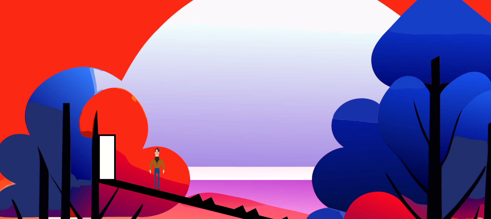
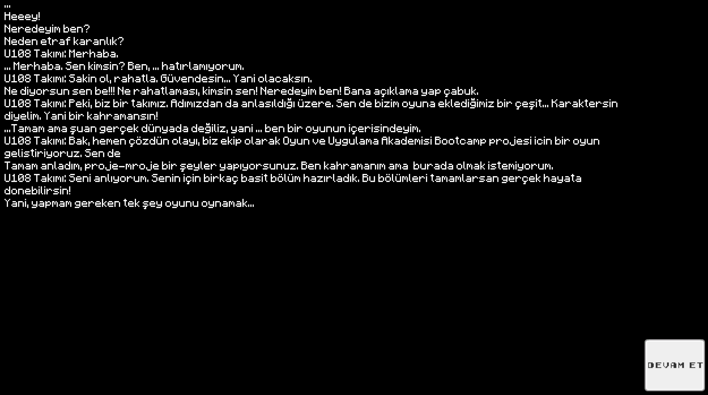
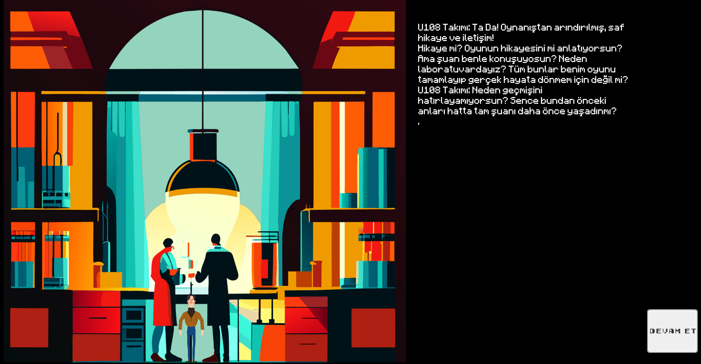
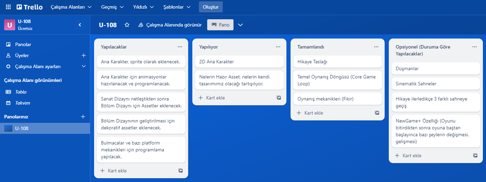
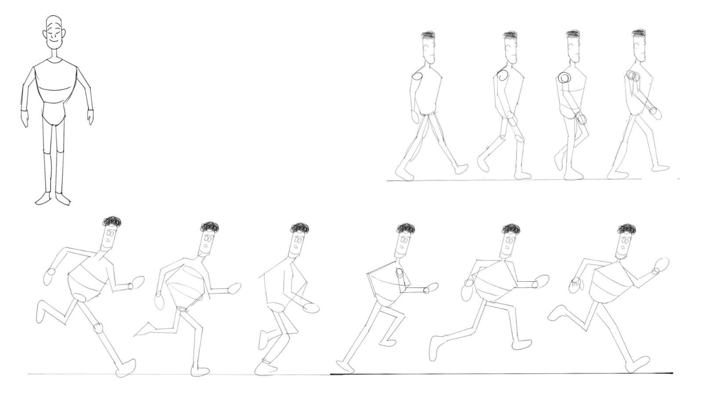

# U-108 · Bootcamp Projesinden Kaçış

**Escape from the Bootcamp Project · a story-driven 2D platformer.**

A character knows he is inside a game. He wants to find a way back to real life.

[Play](#play-it) · [How it was made](#how-it-was-made) · [The remake](https://github.com/OzcanOrhanDemirci/U-108-Remake) · [License](LICENSE)

This repository is kept as it was built in July 2023.

## About

**Bootcamp Projesinden Kaçış** is a short, story-driven 2D platformer set in a near-future science-fiction world. Its main character is trapped inside the project. He does not know how he got there, but knows he is in a game and controlled by a player. Together, they cross platforms and try to escape into real life.

Four people made it as **Team Unity 108 (U-108)** at the **Oyun ve Uygulama Akademisi** bootcamp in summer 2023. It was Özcan Orhan Demirci's first finished piece of software and his first game.

The finished build has eight scenes: a menu, three dialogue scenes, two short platform levels, a laboratory and credits. Dialogue appears letter by letter, with a **Devam Et** (Continue) button; touching spikes restarts the level. The original audience was anyone who enjoys games, primarily ages 12–29, especially fans of platformers such as Celeste and science-fiction stories.

## Screenshots

## Play it

**Windows x64 · about 89 MB · build dated 18 July 2023.** The game is in Turkish.

1. Download **Source code (zip)** from the [latest release](https://github.com/OzcanOrhanDemirci/U-108/releases/latest), or use **Code → Download ZIP** on the [repository page](https://github.com/OzcanOrhanDemirci/U-108). Cloning the repository works too.
2. Extract the ZIP and open `U-108_Build_1.1`.
3. Run `Bootcamp Projesinden Kacis.exe`, keeping the build's files together.

| Control | Action |
| --- | --- |
| **A** | Move left |
| **D** | Move right |
| **W** | Jump |
| Mouse click | Use menu and dialogue buttons |

Movement uses A, D and W; arrow keys and the space bar are not mapped. The mouse is only needed for buttons.

This is an unsigned 2023 build. If Windows SmartScreen warns, choose **More info → Run anyway**.

## How it was made

The team worked in **three Scrum sprints**, planning a **340-point backlog** on [Trello](https://trello.com/b/0ChHet6H/u-108). The targets were 100, 120 and 120 points.

### Sprint 1 · June 2023

Preparation, before active development. The story was reworked to begin bright and colourful, then grow darker and more serious; puzzle and platform mechanics were discussed. University finals made this a busy period.

### Sprint 2 · early July 2023

The team prepared 2D sprites and assets, including the main character and animation sketches, and set the art direction. The Bayram holiday slowed development, leaving the final sprint to finish the game.

### Sprint 3 · July 2023

The game was completed in Unity. The story was simplified, gameplay was simplified to fit the level design, the remaining assets were finished and the code was written. The retrospective's lesson was to be active from the very start of future projects.

### The team

| Member | Role |
| --- | --- |
| Özcan Orhan Demirci | Scrum Master |
| Simge Gürakar | Product Owner |
| Aleyna Temelkaya | Developer |
| Esranur Doğan | Developer |

Unity was used to build the game, Trello to plan it. Communication began with one Discord voice meeting, then continued through WhatsApp, Slack and Discord messages. From sprint 2, daily communication took place on WhatsApp.

## What's in the repository

| Path | Contents |
| --- | --- |
| `Scripts/` | Six C# scripts, 182 lines in total |
| `OriginalAssets/` | Character idle and walk sprites, three level backgrounds and opening scene art |
| `ProjectManagement/` | Sprint 1–3 documents: Trello boards, a Unity screenshot, sketches and in-game screenshots |
| `U-108_Build_1.1/` | The finished Windows build |
| `LICENSE` | MIT license, 2023 |

The Unity project folder itself is not included. This repository holds the scripts, original art, process documents and finished build.

## Built with

**Unity 2022.3.4f1 · C# · 2D.** The scripts use Rigidbody2D physics, Animator and UI Text for movement, jumping, animation, spike deaths, typewriter dialogue, continue buttons, scene changes and quitting.

## The remake (2026)

In 2026, Özcan rebuilt the game from scratch with Claude Code, without an engine, using TypeScript, WebGL2 and .NET WebView2. [U-108 Remake](https://github.com/OzcanOrhanDemirci/U-108-Remake) begins as this 2023 game, then keeps going.

## The original 2023 README, in Turkish

Read the original team introduction and sprint record

# Takım İsmi
Takım Unity 108

# Takım Üyeleri
Özcan Orhan Demirci: Scrum Master

Simge Gürakar: Product Owner

Aleyna Temelkaya: Developer

Esranur Doğan: Developer

# Ürün İle İlgili Bilgiler

## Ürün İsmi
Bootcamp Projesinden Kaçış

## Ürün Açıklaması
Bootcamp Projesinden Kaçış isimli projemiz, hikaye içeren bir platform oyunudur. Oyunumuz yakın gelecekteki bir bilim-kurgu evrenini temel alır. Ana karakter, projenin içerisinde hapsolmuştur ve bu olayın nasıl gerçekleştiğini bilmemektedir ancak  bir oyunun içerisinde olduğunu ve bir oyuncu tarafından kontrol edildiğinin farkındadır. Ana karakter yani oyuncu, hikayeyi deneyimlerken platformlar arasında yol alır ve bu projeden kaçarak gerçek hayata dönmeye çalışır.

## Ürün Özellikleri
Oyuncu; Yürüme ve zıplama gibi temel oynanış mekaniklerini kullanarak çeşitli platformlar ve sahneler arasında ilerler.

Oyuncu, oyunda ilerleyerek hikayeyi deneyim eder.

## Hedef Kitle
Oyunumuzun hedef kitlesi, oyun oynamayı seven herkesi kapsasa da öncelikli olarak 12-29 yaş arası oyuncuların ilgisini çekmeyi amaçlar.

Celeste gibi oynanışın temelinde platform olan oyunları sevenler.

Bilim-Kurgu temelli hikayeleri deneyimlemekten keyif alanlar.

## Not
Takım olarak bazı detayları henüz netleştirmedik. Bu nedenle hikaye ve oynanış başta olmak üzere bazı detaylar zamanla değişebilir. (Hikaye ve oynanış 3.Sprint içerisinde düzenlendi)

# Sprint 1

**Sprint içerisinde tamamlanması tahmin edilen puan:** 100 Puan

**Puan Tamamlama Mantığı:** Proje, 3 Sprint içerisinde tamamlanacak ve toplam 340 puan değerinde Backlog bulunmakta. İlk sprintte en az 100 puan almayı planlıyoruz.

**Daily Scrum:** Discord üzerinden sesli bir toplantı yaptık. Hem tanıştık hem de proje ile ilgili kararları aldık. Ekip olarak zaman sorunları nedeniyle her gün sesli toplantı yapamadık. Bunun yerine WhatsApp, Slack ve Discord üzerinden mesajlaşarak iletişim kurduk.

**Sprint Board Update:** https://trello.com/b/0ChHet6H/u-108

Takım olarak Trello üzerinden projemiz için planlama yaptık. Ekran görüntüsü:

**Ürün Durumu:** 1.Sprint, oyunumuz için aktif bir geliştirme süreci olmadı ancak hazırlıklarımızı tamamladık. 2.Sprintin başlaması ile beraber oyunumuzu geliştirmeye başlayacağız. Ekran görüntüsü:

**Sprint Review:** Hikaye düzenlendi, oyunun sadece renkli ve capcanlı gözükmesi yerine zamanla ciddileşmesi ve daha karanlık hale gelmesi konuşuldu, oynanışı güçlendirmek için bulmaca ve çeşitli platform mekanikleri tartışıldı.

**Sprint Retrospective:** Üniversite finalleri başta olmak üzere Bootcamp sürecinin yoğun bir döneme denk geldiğini ancak 2.Sprintte daha fazla çalışarak bunu telafi etmemiz gerektiğini konuştuk.

# Sprint 2

**Sprint içerisinde tamamlanması tahmin edilen puan:** 120 Puan

**Puan Tamamlama Mantığı:** Toplam 340 puanlık Backlog kapsamında 2.Sprint içerisinde 120 puan almayı planlıyoruz. Bu sayede bir sonraki sprintte de 120 puan almaya gayret ederek toplam 340 puanlık backlog hedefine ulaşabiliriz.

**Daily Scrum:** Günlük iletişimi WhatsApp üzerinden sürdürmeye karar verdik ve proje hakkında WhatsApp üzerinden konuştuk.

**Sprint Board Update:** https://trello.com/b/0ChHet6H/u-108
Trello ekran görüntümüz:

**Ürün Durumu:** Bu Sprint içerisinde projemizin Assetlerini (Spritelar) hazırladık.

Ana karakter ekran görüntüsü:

Animasyonlar için taslağımız:

**Sprint Review:** Hikaye düzenlendi. Ana karakter ve bölüm dizaynı için 2D spritelar üzerinde çalışıldı. Oyunun sanat dizaynı belirlendi. Oynanışı çeşitlendirmek için çeşitli oynanış mekanikleri üzerine konuşuldu.

**Sprint Retrospective:** Bayram nedeniyle geliştirme süreci çok hızlı ilerlemedi. Ekibin önümüzdeki son sprintte aktif bir geliştirme süreci içerisine girerek oyunu tamamlaması gerektiği konuşuldu.

**Sprint Notları:** Bu sprint içerisinde oyunun assetlerini yani 2D spritelarını tasarlamaya (Veya hazır bulmaya) odaklandık. Ana karakter başta olmak üzere assetlerin büyük bölümü hazırlandı. Önümüzdeki son sprintte kalan assetleri tamamlayıp oyunu geliştirmeye devam edeceğiz.

# Sprint 3

**Sprint içerisinde tamamlanması tahmin edilen puan:** 120 Puan

**Puan Tamamlama Mantığı:** Toplam 340 puanlık Backlog bulunmakta. İlk 2 Sprint ile 220 puan almayı hedefledik. Bu son sprint ile kalan 120 puanı tamamlamayı planlıyoruz.

**Daily Scrum:** 2.Sprint içerisinde aldığımız kararı (İletişimi WhatsApp üzerinden sağlamak) devam ettirdik ve günlük iletişimimizi sürdürdük.

**Sprint Board Update:** https://trello.com/b/0ChHet6H/u-108
Trello ekran görüntülerimiz:

**Ürün Durumu:** Bu Sprint içerisinde projemizi tamamladık.
Oyun içi ekran görüntülerimizi:

**Sprint Review:** Hikaye, son kez düzenlenip sadeleştirildi. Oynanış basitleştirildi ve bölüm dizaynına uygun hale getirildi. Eksik kalan Assetler Tamamlandı. Oyunun kodları yazıldı ve oyun, Unity ile geliştirildi.

**Sprint Retrospective:** Bu sprint içerisinde, bir önceki sprintte alınan ekibin daha aktif olması gerektiği kararı uygulanmaya çalışıldı. Ekibin ileride yer alacağı diğer projelerde en baştan itibaren daha aktif olması gerektiği öz eleştirisi yapıldı.

**Sprint Notları:** Bu sprint içerisinde oyunu tamamlamaya odaklandık. Eksik kalan assetleri hazırladık ve oyunun kodlarını yazdık. 

## License and contact

[MIT](LICENSE) · Copyright © 2023 Özcan Orhan Demirci.

[Özcan Orhan Demirci](https://github.com/OzcanOrhanDemirci) · [mail@ozcanorhandemirci.com](mailto:mail@ozcanorhandemirci.com)
